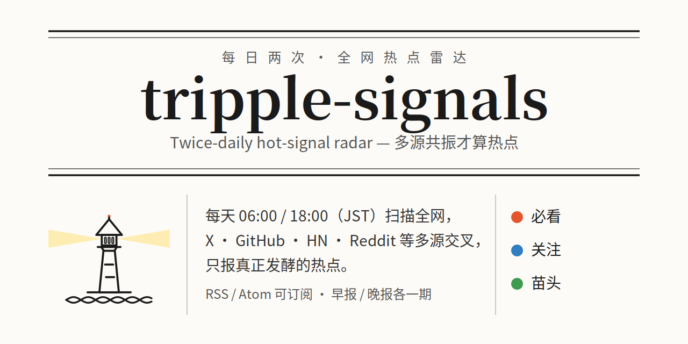

# tripple-signals

全网热点雷达：在热点到达大众搜索之前，从源头层抓到它。扫描频度由使用者自行定义，程序也可自行发现并更新。

方法论见 [methodology.md](methodology.md)（写给人看的完整版）。公开站点与订阅（RSS/Atom）的计划见 [ROADMAP.md](ROADMAP.md)。本仓库把它拆成 agent 能直接用的四层：

| 层 | 文件 | 作用 |
|---|---|---|
| 指令 | `skills/tripple-signals/SKILL.md` | agent 照着跑的执行步骤、判定规则、报告模板 |
| 配置 | `config.example.yaml` | 信息源清单、量化门槛、关键词、时区与期次——调参只动这里（YAML，JSON 兼容） |
| 工具 | `radar/` | 确定性工作交给代码：状态存储、去重、14 天复盘（抓取器见路线图） |
| 状态 | `state/seen-topics.json` | 话题台账（机器版）；`seen-topics.md` 是给人看的视图 |

设计参考 [zhuyansen/new-term-radar](https://github.com/zhuyansen/new-term-radar)：热点有传播顺序（X/HF 首发 → GitHub 爆发 → 目录/媒体 → Google Trends），雷达读前两步，Trends 只用来事后验证。

## 快速开始

```bash
python -m radar        # 一键扫描：按本地时间自动选期次，跑全部源，写候选文件
```

就这一条命令（零依赖，不用先装任何东西）。候选文件出来后，把它和 `skills/tripple-signals/SKILL.md` 交给你的 agent 出报告。其他用法：

```bash
cp config.example.yaml config.yaml   # 按需改源、门槛和关键词，config.yaml 不进 git
python -m radar scan --edition morning   # 显式指定期次
python -m radar review               # 列出到期该复盘的话题（14 天规则）
pip install -e .                     # 装成命令后可直接运行 `radar`
python -m pytest -q tests            # 逻辑测试，不碰网络
```

配置是 **YAML**（`config.yaml`；装了 PyYAML 用完整语法，没装时内置子集解析器，仅标准库也能跑），旧的 `config.json` 照常兼容，加载顺序：`config.yaml > config.yml > config.json > config.example.*`。

给 agent 用：把 `skills/tripple-signals/` 装进你的 agent（Claude Code / Codex 等），或直接让 agent 读 SKILL.md 按步骤执行。定时运行有两种方式：

- 本机/常驻 agent：用 agent 自己的调度（如 Muse 的 cron），早晚各一次——当前 Dai 的实际运行方式。
- GitHub Actions：`.github/workflows/radar.yml` 已备好骨架，设仓库变量 `RADAR_ENABLED=true` 后生效（需要先补上抓取层，见路线图）。

## 抓取层（0.3.0 扩源）

`python -m radar scan --edition morning` 跑全部抓取器，候选写入 `state/candidates-<日期>-<期次>.json`。

### 信息源清单（共 22 个，21 个完全免费）

**21 个源完全免费：免付费、免注册、免 API key**，clone 下来就能跑。只有 X 一个例外（官方 API 收费）。

| 信息源 | 层 | 读什么 | 费用 |
|---|---|---|---|
| 官方博客组（OpenAI、DeepMind、Google Research、Hugging Face、Mistral、NVIDIA、AWS ML、GitHub Blog、BAIR） | L1 源头 | 实验室/公司一手公告（RSS，仿 [AIHOT](https://github.com/KKKKhazix/AIHOT) 的 T1 分级） | 免费 |
| GitHub | L1 源头 | 爆发仓库（Search API）+ Trending 页 | 免费 |
| Hacker News | L1 源头 | 首页/高分新帖（Algolia API） | 免费 |
| Show HN | L1 源头 | 独立产品发布帖（Algolia API） | 免费 |
| Hugging Face Models | L1 源头 | Trending 模型前 50 的新面孔 | 免费 |
| HF Spaces | L1 源头 | Trending Spaces 前 50（人们真正上手试的 demo） | 免费 |
| OpenRouter | L1 源头 | 最新上架模型（按创建时间排序） | 免费 |
| Civitai | L1 源头 | 最新社区模型（仅 SFW） | 免费 |
| arXiv | L1 源头 | cs.AI / cs.CL / cs.LG 最新提交论文 | 免费 |
| HF Daily Papers | L1 源头 | HF 社区票选论文（arXiv 的已筛选版） | 免费 |
| Bluesky | L1 源头 | 配置账号的公开 RSS（博主 + 媒体，免 key 读 Bluesky 的路） | 免费 |
| Product Hunt | L1 源头 | 当日新品（公开 Atom feed；有 token 时走 GraphQL 取票数） | 免费 |
| X | L1 源头 | 关键账号的新动态 | ⚠️ 需自备 `X_BEARER_TOKEN`（官方 API 付费）；未配置时如实报缺失，由 agent 网页扫补位 |
| Reddit | L2 发酵 | 配置版块的热帖（JSON，失败自动降级 RSS） | 免费 |
| 科技媒体组（TechCrunch、The Verge、Ars Technica、MIT Technology Review、The Decoder、Simon Willison、Import AI、Latent Space） | L2 发酵 | 媒体报道 + 独立作者（RSS，AIHOT 的 T2 分级） | 免费 |
| DEV (dev.to) | L2 发酵 | 开发者社区当日热文 | 免费 |
| Lobsters | L2 发酵 | hottest 列表，与 HN 互为交叉验证 | 免费 |
| Mastodon | L2 发酵 | 大实例（mastodon.social）的 trending links/tags，附当日独立账号数 | 免费 |
| 目录站 sitemap 组（Futurepedia、Toolify、dang.ai） | L2 发酵 | AI 工具目录的新工具页（借鉴 [new-term-radar](https://github.com/zhuyansen/new-term-radar) 的 sitemap 信号） | 免费 |
| App Store | L2 发酵 | 美区畅销榜 + 免费榜（接口不稳时自动降级旧版 iTunes feed） | 免费 |
| Wikipedia 热读榜 | L2 发酵 | 英文维基昨日浏览 Top（大众注意力 + 社会观察） | 免费 |
| Google News | L2 发酵 | 科技/AI 头条（RSS） | 免费 |

另有 L3 验证层 Google Trends（免费）：只核对已入选话题的曲线，从不作为发现来源，不占抓取器名额。

- **组源只算一个源**：官方博客组、科技媒体组、sitemap 组内部再多家，跨源共振时整组计 1——通稿被十家转述、工具被五个目录抄录，都不算多源共振。
- 2026-11-13 实测：22 个源 21 个实时出数，仅 X 缺失（无 token）。
- MCP server 已可用（`python -m radar.mcp_server`，仅标准库）：工具 `radar_scan`、`radar_review`。

## 用户可控选项（0.4.0）

都在 `config.yaml` 里，不填就用默认行为，老配置文件原样能跑：

| 选项 | 写法 | 作用 |
|---|---|---|
| 屏蔽词 | `keywords.mute: [giveaway, airdrop]` | 命中（标题+摘要，子串、不分大小写）的候选直接丢弃 |
| 关注词 | `keywords.boost: [mcp]` | 命中打标，agent 分级时可把单源苗头升为关注 |
| 必看词 | `keywords.alert: [gemini]` | 命中打标并汇入候选文件的 `keyword_alerts`；再有第二源共振，agent 直接列为必看候选 |
| 主题权重 | `topics: {AI Agents: 5, 社会观察: 2}` | 相关性打分按你的优先级（1–5），换行业主要改这一节 |
| 每源开关 | `sources.<源>.enabled: false` | 关掉某个源；报告里单列「已停用」，不算缺失 |
| 每源上限 | `sources.<源>.max_items: 20` | 抓完后统一截断（区别于各源自己的抓取参数 `limit`） |
| 新鲜度窗口 | `filters.max_age_hours: 72` | 只对带时间戳的候选生效，太旧的丢弃；无时间戳的不拦 |

## 路线图

1. **复盘自动化**：review 结果按源统计命中率，自动调整各源权重。
2. **GitHub Actions 实跑**：workflow 文件补齐后，把 scan 接进定时任务（当前雷达由 agent 侧 cron 驱动）。

## 边界

只读公开信息，不发帖、不互动；密钥只走环境变量，不进仓库。见 [PRIVACY.md](PRIVACY.md)。
